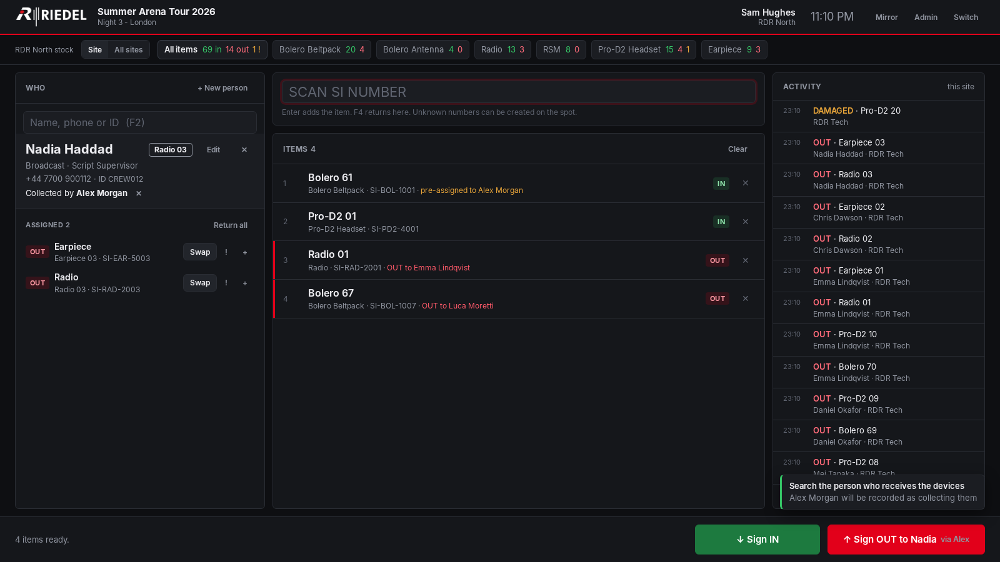
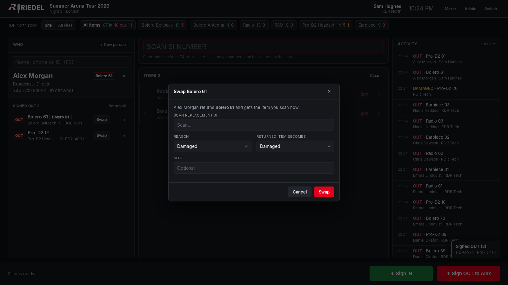
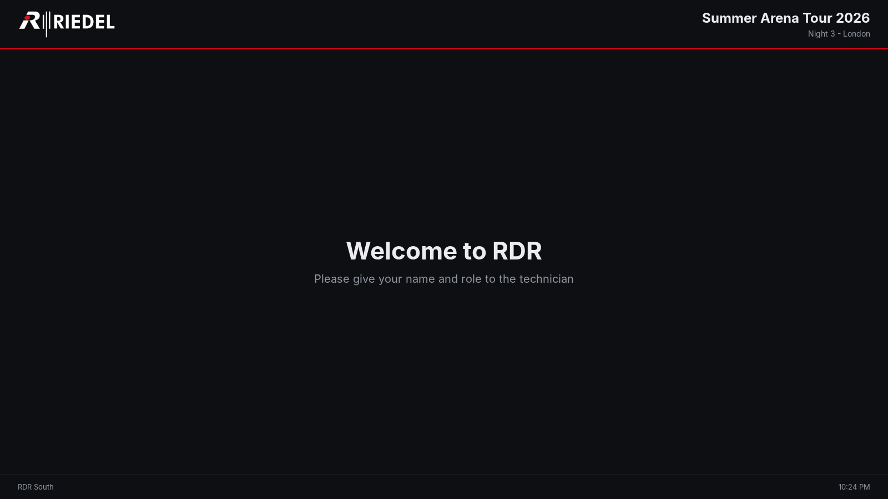
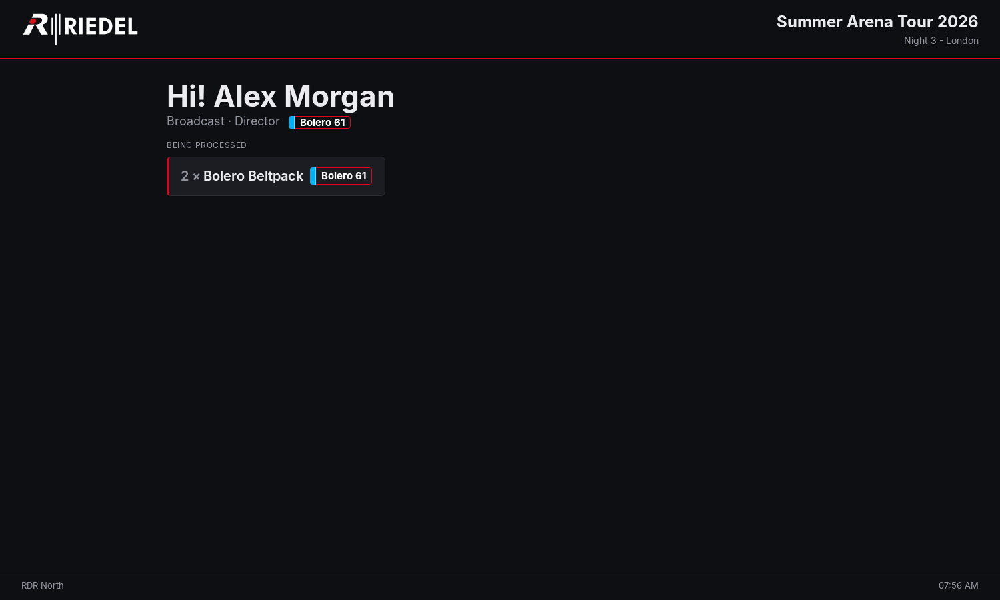
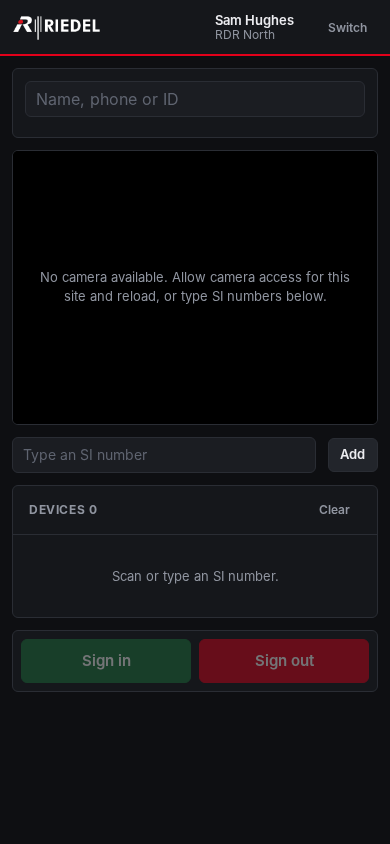
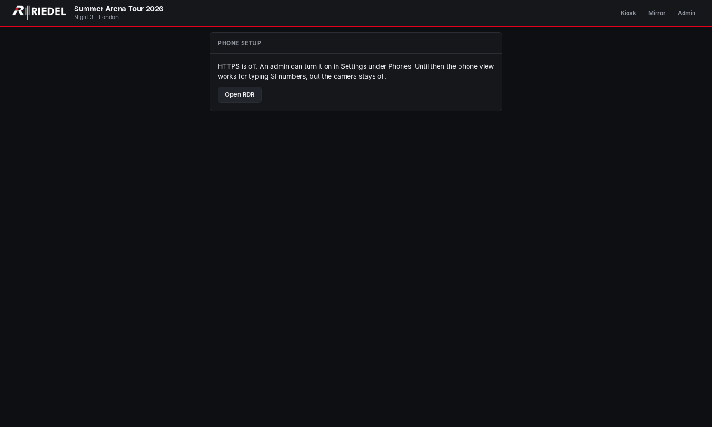
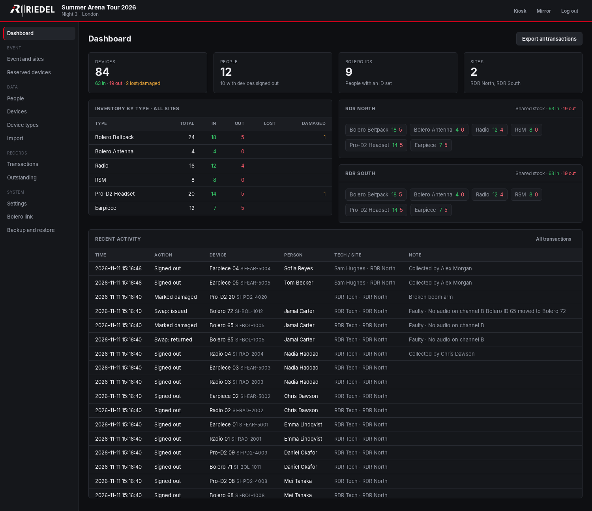
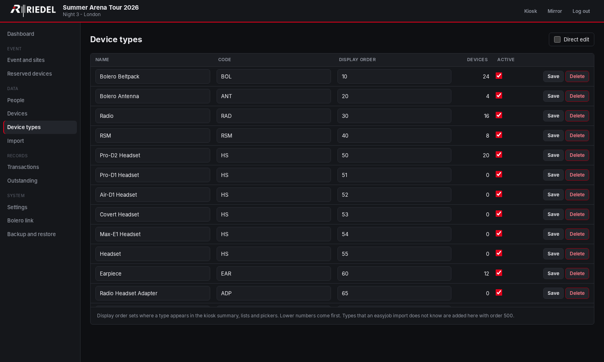
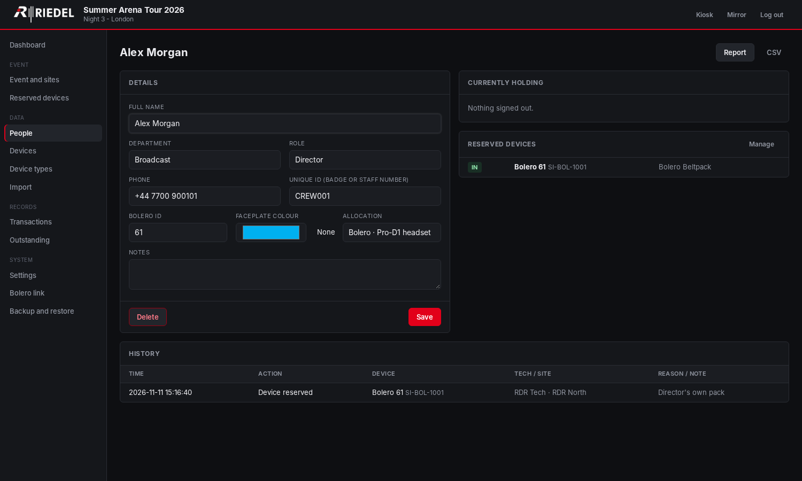
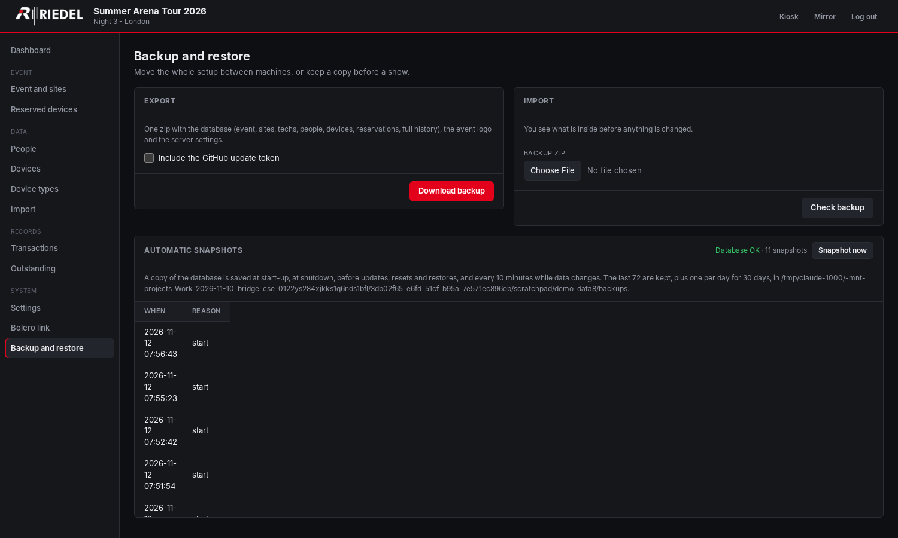

# RDR: Radio Distribution Room

Sign-out / sign-in and warehousing for comms devices at live events: Bolero
beltpacks, radios, RSMs, headsets, earpieces and anything else with an SI
barcode. Runs on a Windows 11 box, stores everything locally in SQLite, and is
used from browsers on the LAN (kiosk PC, customer-facing mirror screen, phones).

## Install (Windows, one click)

1. Download **RDR-Setup-&lt;version&gt;.exe** from the latest
   [GitHub release](https://github.com/odd-one77/rdr/releases/latest).
2. Run it. No admin rights needed: it installs to `%LOCALAPPDATA%\RDR` with its
   own embedded Python, adds Start Menu and Desktop shortcuts, and starts RDR
   as a tray application: no window, just an icon in the hidden icons area.
   Left-click the icon for Settings; right-click for kiosk, mirror, restart
   and quit. "RDR (console window)" in the Start Menu runs it with a visible
   log instead.
3. The browser opens on `http://localhost:8080`. Go to **Admin**, set the
   admin password, then **Event** to name the event, upload the logo and add
   sites and technician usernames.

Windows Firewall asks once whether to allow Python on the network; say yes so
phones and the mirror screen can reach it. Other machines on the LAN use
`http://<pc-ip>:8080`; the address is shown in Admin under Settings, on the Server tab.

Upgrading: in Admin open Settings, Updates tab, and press **Update and restart**. It downloads the newest
release and swaps the app code in place. The repo is private, so paste a
GitHub fine-grained token (Contents: read) under *Update source* once.
Re-running a newer setup exe over the top also works and keeps `data/`.

### Developer start (git checkout)

Install Python 3.11+ and Git, `git clone` the repo and double-click
`RDR.bat`: it creates `.venv`, installs requirements and starts the server.
In this mode *Update and restart* uses `git pull`.

| URL | What |
|-----|------|
| `/` | Kiosk (tech picks name + site on first open) |
| `/m` | Phone view with camera scanning (needs the https address) |
| `/mirror?site=1` | Customer-facing mirror for a second screen, with PGM feed |
| `/trust` | Phone setup: install the local certificate once |
| `/admin` | Admin: event, people, devices, imports, reports, settings, backup |

## Everyday use

- **Sign out**: type the person's name (or phone / ID), pick them, scan devices,
  press *Sign out*. Devices already out to someone else are flagged; you decide
  to reassign or leave them.
- **Sign in**: scan devices, press *Sign in*. No person needed. Scanning a device
  that is already in stock is ignored but the scan is still timestamped.
- **Swap**: on the person's held device press *Swap*, scan the replacement, pick
  a reason. The returned device is marked damaged / lost / OK.
- **Lost / damaged**: the `!` button on a held device.
- **Bolero IDs** are planned on the person (people sheet or person page); some
  people have one, radio-only people don't. Nothing is matched until the first
  Bolero pack is scanned out to them: the pack is then linked to their ID (or,
  if the person has no ID and the pack came in with one from the device sheet,
  the person takes the pack's ID). The ID stays on the pack when it comes back;
  the kiosk warns when a pack configured as one ID goes to someone with
  another. On a swap the IDs trade places: the spare becomes the person's ID
  and the damaged pack takes the spare's old ID. Beside each name the kiosk
  and mirror show a Bolero chip, a Radio chip, both, or nothing, depending on
  what the person has.
- **Collecting for others**: select the collector and press "Picking up for
  other people?" under their assigned devices. A red strip shows who is
  collecting; search and add each person they collect for. Each person's
  reserved devices join the list, and anything scanned goes to whichever name
  is selected on the strip (devices show "for Priya"). One Sign out issues every
  person's devices, with the collector noted in the history. The strip counts what
  went to whom; Exit (or Escape) ends it.
- **Edit details** on the kiosk person card fixes a name, role, phone or
  Bolero ID without leaving the counter. In Admin, People and Device types
  have a **Direct edit** toggle that turns the table into editable cells
  which save as you leave them.
- The kiosk menu (three bars, top right) holds Mirror, Admin, phone setup
  and Switch tech.
- **Live settings**: kiosks, phones and mirrors pick up admin changes within a
  few seconds without a refresh: event name and logo, tech and site names,
  device types, mirror wording, PGM feed and feed size. A feed added to a
  site appears on its mirror in place; removing it returns the mirror to full
  width. A tech or site that is deactivated sends its kiosk back to the start
  screen.
- Several counters: each kiosk tab is pinned to the site it was opened with,
  so two tabs in one browser feed their own mirrors; a mirror falls back to
  the splash if its kiosk has been silent for 15 minutes.
- **Reserved devices**: a particular serial number held for a particular
  person, for the rare case. Set them in Admin under Reserved devices.
- **Unknown barcode**: the kiosk offers to create the device on the spot.

A USB barcode scanner works as a keyboard: the scan box always has focus and
Enter adds the device. Typing part of an SI (the last four digits, say) lists
matching devices with full SI, type, label and status; arrow keys and Enter
pick one. F2 jumps to the name search, F3 recalls the previous person, F4
returns to the scan box.

## Phones

Phones always get the phone view and desktops always get the kiosk; the
server decides from the browser. In Admin open Settings, Phones tab, and turn on **HTTPS for phones**. RDR then also listens on
`https://<pc-ip>:8443`. On each phone open `http://<pc-ip>:8080/trust`, install
the certificate as described there, then use the https address and `/m`. The
camera reads Code 128/39, EAN, QR and Data Matrix labels. Without HTTPS the
phone view still works for typing SI numbers.

## Mirror and programme feed

`/mirror?site=<id>` is the customer-facing screen. Idle, it shows the welcome
line, or one of your own sayings, or, with the "Movie quotes" box ticked in
Settings, one of fifty well-known film lines with its credit underneath. The
line changes each time the screen returns from a transaction. Below it the
screen asks for name and role, naming the tech on that site's kiosk. During a transaction it greets the person and lists what they
are getting by type ("2 × Pro-D2 Headset", "Bolero Beltpack · Bolero 61"),
never serial numbers; those stay on the technician's side. Give a site a feed address under Event and sites and the mirror
shows it next to the transaction: an RTSP address is relayed to HLS by the
bundled ffmpeg, a capture card such as a Blackmagic DeckLink is taken as
`dshow:<device name>` ("List capture devices" on the Settings Mirror screen tab shows the names;
`dshow:Blackmagic WDM Capture?video_size=1920x1080&framerate=25` sets a
format), a YouTube link is embedded (handy for testing the layout), and direct
`.m3u8` or `.mp4` links play as they are. Tick "Re-encode" in Settings
if an RTSP source is not H.264.

## Data safety

Every change is committed to SQLite with full disk sync before the kiosk gets
its answer. The database is snapshotted to `data/backups/` at start-up, at
shutdown, before updates, resets and restores, and every 10 minutes while data
changes; the last 72 plus one per day for 30 days are kept and can be
downloaded or restored from Backup and restore in Admin. An integrity check runs
at every start.

Admin logins expire after 20 idle minutes and are dropped whenever a tech picks
their name on the start screen, so a kiosk never carries an admin session.

## Away from desk

The kiosk menu has **Away from desk**: Be right back, 5/10/15/30 minutes, an
hour, or a clock time, with an optional note. It locks that site's kiosk and
phone view behind the admin password (the lock survives a reload and shows on
every tab of the site) and the mirror keeps the programme feed but replaces the
welcome with "Back in 7 min", "Back at 14:35" or "Be right back", counting down
and then "Back any moment". Reopen with the admin password on the lock screen,
or from the admin dashboard.

## Bolero antenna link (optional)

The Bolero link page (admin sidebar, under System) takes the address of the core
(DECT master) antenna of a Bolero system, standalone (AES67) or Artist-connected. RDR then reads pack status through the antennas' own web
interface (the same undocumented REST interface the Riedel page uses, read-only
account): whether the pack carrying a person's Bolero ID is on, its battery and
antenna, and, when the system has the Charger Monitoring licence, which charger
bay a docked pack sits in. The kiosk shows this under the person's details, so
the tech can find the pack. With the admin password saved, selecting the person flashes their pack for ten
seconds through its charger bay (a **Flash it** button repeats it), when the
pack is docked in a networked charger with the Charger Monitoring licence. A
pack that is not in a charger is never flashed. The
exact charger resource differs by firmware; the explorer on the same page shows
the raw answers so it can be found and set on site. Unofficial interface: a firmware
update may change it.

## Backup and moving machines

Backup and restore in Admin exports one zip with the database, logo and server
settings. On the other machine install RDR, go to Backup and restore, upload the
zip, check the summary, type RESTORE. The server restarts on the restored data.

## Imports

Import in Admin has two sources. **easyjob import** takes the delivery note
PDF or the easyjob export (`.xlsx` / `.csv`) for devices; **Allocation**
takes the comms allocation sheet for people. From the delivery note PDF, every barcode (`@si…`) becomes a device and the
description picks the type (BL-BPK → Bolero Beltpack, PRO-D1 / PRO-D2 /
AIR-D1 / MAX-E1 / Covert → that headset, HC Headset Cord → Radio Headset
Adapter, Hytera / Motorola → Radio, RSM → RSM). The same rules apply to an export sheet whose
"Article" column carries the description. Panels, antennas, chargers,
batteries, covers, power, cables and cases are listed as ignored on the
review screen, never created as device types. Scanners that send the
leading `@` still match. Columns are mapped on screen, so the
layout of the sheet does not matter; a title row above the headings is
handled (pick the header row on the mapping screen if the guess is wrong).
Re-importing updates existing records; look-alike people are flagged with
options (update / create / skip).

The comms **allocation sheet** imports as people: Bolero # → Bolero ID,
Position → department, Role Name → role, Person → name, Pack and Headset →
an allocation line, and the coloured blank column → **faceplate colour**,
read from the cell fill. Placeholder names (TBA, blank) are kept as
"Position (TBA)", or "Role name (TBA)" when there is no position, so the ID is
not lost, and the kiosk search finds them by role or position until the real
name is typed in with Edit; a name repeated with another ID
becomes a second entry named by position. The faceplate colour shows as a
band on the Bolero chip beside the person's name on the kiosk and mirror.

## Releasing a new version

1. Bump `__version__` in `app/__init__.py` and commit.
2. Tag and push: `git tag v0.2.0 && git push origin v0.2.0`.
3. GitHub Actions (`.github/workflows/release.yml`) runs the tests, builds
   `RDR-Setup-0.2.0.exe` and `rdr-app-0.2.0.zip` on a Windows runner and
   publishes the release. Installed copies pick it up via *Update and restart*.

To build locally on Windows: `powershell -File installer\build_windows.ps1`
(needs Inno Setup 6 for the exe; without it you still get `dist\RDR`).

## Reset

In Admin open Settings, Data tab. **Reset database** wipes everything for a brand new setup
(optionally keeping the admin password).

## Development

```
python -m venv .venv && .venv/bin/pip install -r requirements.txt
python run.py --reload --no-browser
python -m pytest            # tests in tests/
```

Layout: `app/main.py` (FastAPI app), `app/launcher.py` (process supervisor
used by `run.py` and `tray.py`), `app/db.py` (schema), `app/services/`
(inventory rules, importer, updater), `app/routers/` (kiosk, api, admin),
`app/templates/` + `app/static/` (server-rendered UI, no build step).

Branding: `app/static/img/riedel.png` is the Riedel logo in white for the dark UI;
`riedel-dark.png` is the black-on-transparent version for print.

## Roadmap

Ideas not built yet: signature capture on pickup, label printing for new
devices, per-event archives, multi-event history.

## Screenshots (demo data)

| Start screen | Kiosk |
|---|---|
|  |  |

| Picking up for someone else | Conflict decision | Swap | Unknown barcode |
|---|---|---|---|
|  |  |  |  |

| Mirror idle | Mirror processing | Mirror done |
|---|---|---|
|  |  |  |

| Phone view | Phone setup |
|---|---|
|  |  |

| Admin dashboard | Reports (end of event) | Device types |
|---|---|---|
|  |  |  |

| Event and sites | Devices | Person |
|---|---|---|
|  |  |  |

| Backup and restore | Import: map columns | Import: review | Settings |
|---|---|---|---|
|  |  |  |  |
