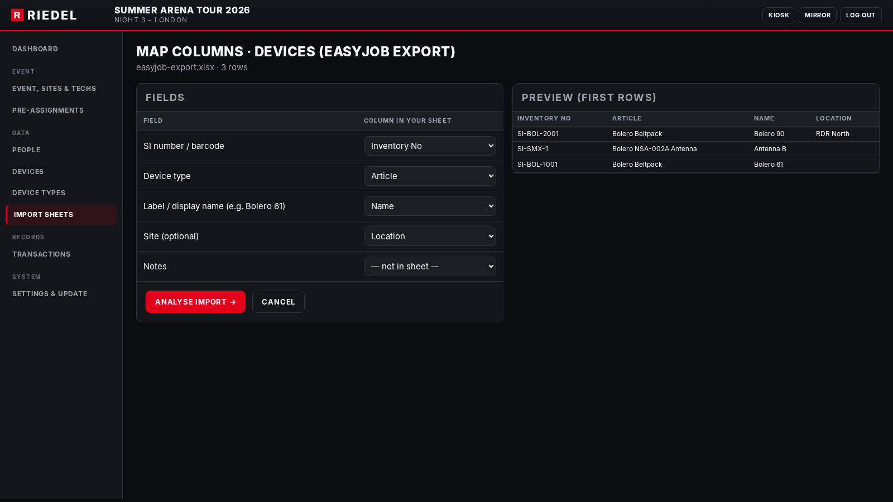
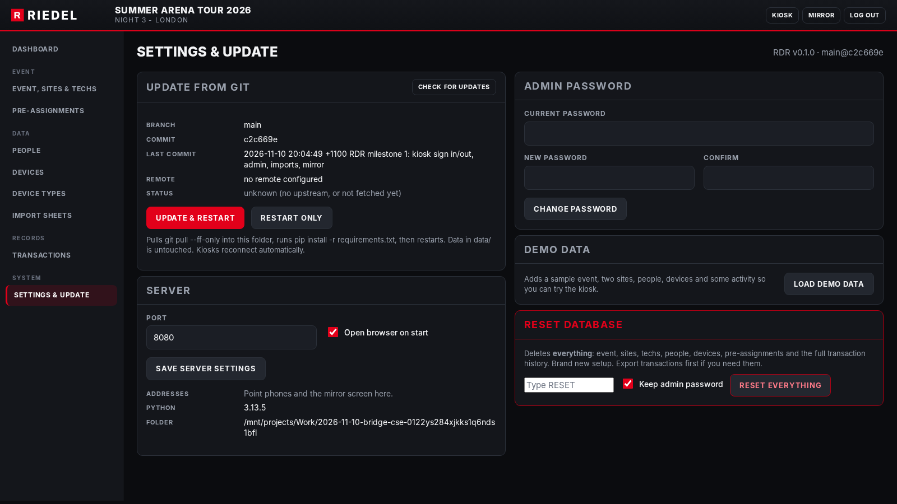
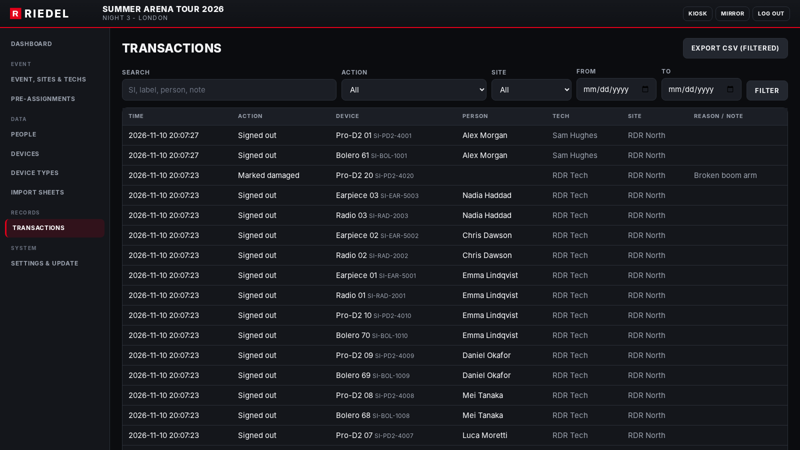

# RDR — Radio Distribution Room

Sign-out / sign-in and warehousing for comms kit at live events: Bolero
beltpacks, radios, RSMs, headsets, earpieces and anything else with an SI
barcode. Runs on a Windows 11 box, stores everything locally in SQLite, and is
used from browsers on the LAN (kiosk PC, customer-facing mirror screen, phones).

## Quick start (Windows)

1. Install Python 3.11+ from python.org (tick *Add python.exe to PATH*).
2. Install Git for Windows (needed for the in-app *Update from Git*).
3. `git clone <repo-url> RDR` and double-click **`RDR.bat`**.
4. The browser opens on `http://localhost:8080`. Go to **Admin**, set the
   admin password, then **Event** to name the event, upload the logo and add
   sites and technician usernames.

Other machines on the LAN use `http://<pc-ip>:8080`; the address is shown in
Admin → Settings.

| URL | What |
|-----|------|
| `/` | Kiosk (tech picks name + site on first open) |
| `/mirror?site=1` | Customer-facing mirror for a second screen |
| `/admin` | Admin: event, people, devices, imports, transactions, settings |

## Everyday use

- **Sign out**: type the person's name (or phone / ID), pick them, scan items,
  press *Sign OUT*. Items already out to someone else are flagged; you decide
  to reassign or leave them.
- **Sign in**: scan items, press *Sign IN*. No person needed. Scanning an item
  that is already in stock is ignored but the scan is still timestamped.
- **Swap**: on the person's held item press *Swap*, scan the replacement, pick
  a reason. The returned item is marked damaged / lost / OK.
- **Lost / damaged**: the `!` button on a held item.
- **Pre-assignments**: Admin → Pre-assignments, or import a sheet. The kiosk
  shows them under the person with one-click *Add all*.
- **Unknown barcode**: the kiosk offers to create the device on the spot.

A USB barcode scanner works as a keyboard: the scan box always has focus and
Enter adds the item. F2 jumps to the name search, F4 back to the scan box.

## Imports

Admin → Import sheets accepts `.xlsx` / `.csv` for **people**, **devices**
(easyjob export) and **pre-assignments**. Columns are mapped on screen, so the
layout of the sheet does not matter. Re-importing updates existing records;
look-alike people are flagged with options (update / create / skip).

## Updating during prototyping

Admin → Settings → **Update & restart** runs `git pull --ff-only`, reinstalls
`requirements.txt` and restarts the server. No reinstall needed. The database,
uploaded logo and import staging live in `data/` and are never touched by git.

## Reset

Admin → Settings → **Reset database** wipes everything for a brand new setup
(optionally keeping the admin password).

## Development

```
python -m venv .venv && .venv/bin/pip install -r requirements.txt
python run.py --reload --no-browser
python -m pytest            # tests in tests/
```

Layout: `app/main.py` (FastAPI app), `app/db.py` (schema), `app/services/`
(inventory rules, importer, updater), `app/routers/` (kiosk, api, admin),
`app/templates/` + `app/static/` (server-rendered UI, no build step).

Branding: `app/static/img/riedel.svg` is a placeholder wordmark. Drop the real
Riedel logo in its place (same filename) to replace it everywhere.

## Roadmap

Phase 2: phone camera scanning (needs the optional HTTPS switch), RTSP
programme feed on the mirror, per-site stock reports, phone-sized layout.

## Screenshots (demo data)

| Start screen | Kiosk |
|---|---|
|  |  |

| Conflict decision | Swap | Unknown barcode |
|---|---|---|
|  |  |  |

| Mirror (processing) | Mirror (done) |
|---|---|
|  |  |

| Admin dashboard | Devices | Person |
|---|---|---|
|  |  |  |

| Import: map columns | Import: review | Settings & update | Transactions |
|---|---|---|---|
|  |  |  |  |
