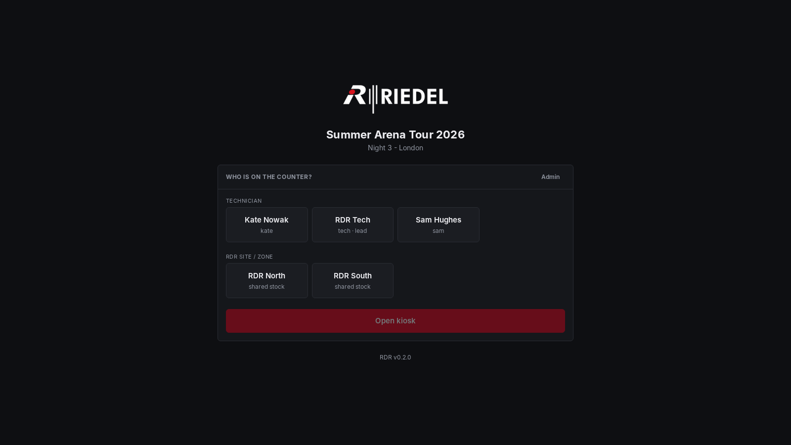
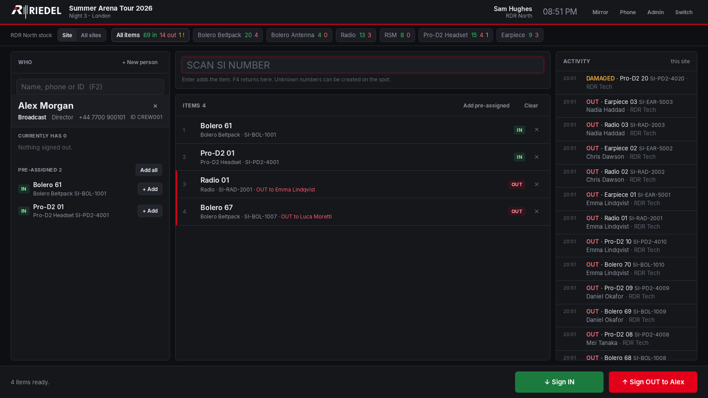
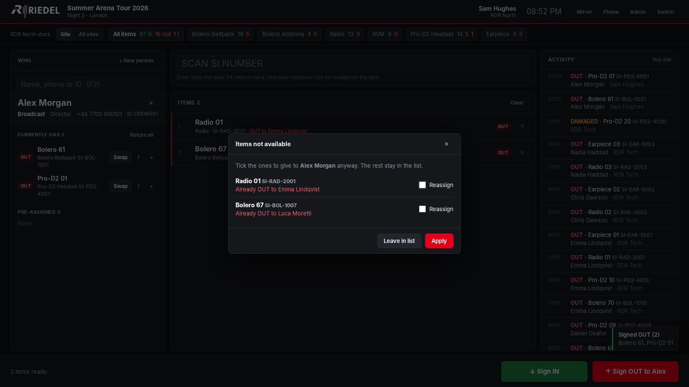
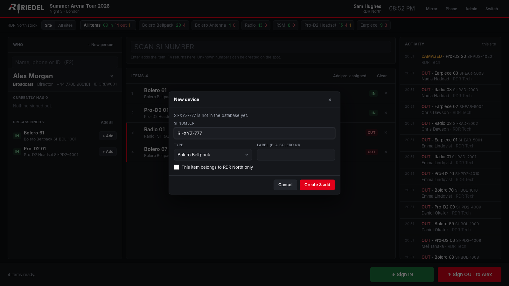
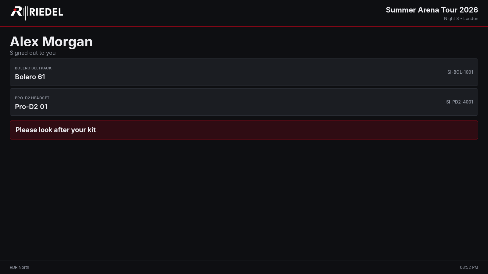
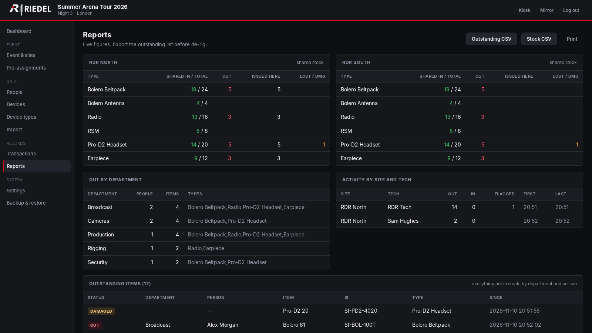
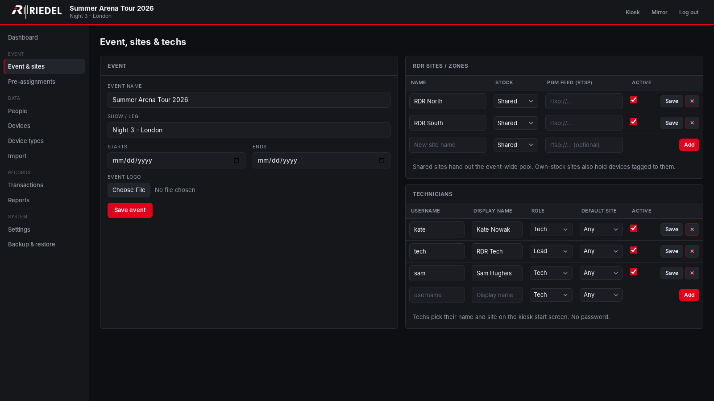
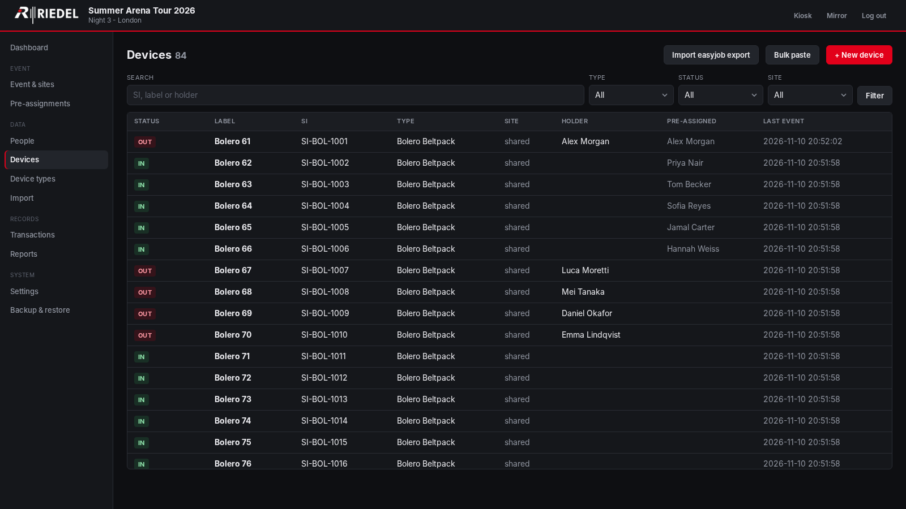
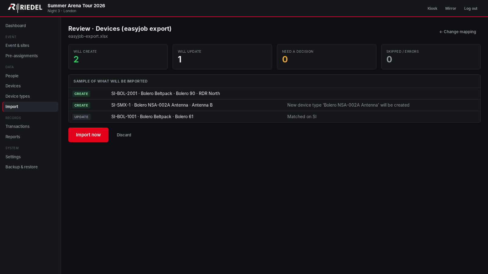

# RDR — Radio Distribution Room

Sign-out / sign-in and warehousing for comms kit at live events: Bolero
beltpacks, radios, RSMs, headsets, earpieces and anything else with an SI
barcode. Runs on a Windows 11 box, stores everything locally in SQLite, and is
used from browsers on the LAN (kiosk PC, customer-facing mirror screen, phones).

## Install (Windows, one click)

1. Download **RDR-Setup-&lt;version&gt;.exe** from the latest
   [GitHub release](https://github.com/odd-one77/rdr/releases/latest).
2. Run it. No admin rights needed: it installs to `%LOCALAPPDATA%\RDR` with its
   own embedded Python, adds Start Menu and Desktop shortcuts, and starts RDR.
3. The browser opens on `http://localhost:8080`. Go to **Admin**, set the
   admin password, then **Event** to name the event, upload the logo and add
   sites and technician usernames.

Windows Firewall asks once whether to allow Python on the network; say yes so
phones and the mirror screen can reach it. Other machines on the LAN use
`http://<pc-ip>:8080`; the address is shown in Admin → Settings.

Upgrading: Admin → Settings → **Update & restart** downloads the newest
release and swaps the app code in place. The repo is private, so paste a
GitHub fine-grained token (Contents: read) under *Update source* once.
Re-running a newer setup exe over the top also works and keeps `data/`.

### Developer start (git checkout)

Install Python 3.11+ and Git, `git clone` the repo and double-click
`RDR.bat`: it creates `.venv`, installs requirements and starts the server.
In this mode *Update & restart* uses `git pull`.

| URL | What |
|-----|------|
| `/` | Kiosk (tech picks name + site on first open) |
| `/m` | Phone view with camera scanning (needs the https address) |
| `/mirror?site=1` | Customer-facing mirror for a second screen, with PGM feed |
| `/trust` | Phone setup: install the local certificate once |
| `/admin` | Admin: event, people, devices, imports, reports, settings, backup |

## Everyday use

- **Sign out**: type the person's name (or phone / ID), pick them, scan items,
  press *Sign OUT*. Items already out to someone else are flagged; you decide
  to reassign or leave them.
- **Sign in**: scan items, press *Sign IN*. No person needed. Scanning an item
  that is already in stock is ignored but the scan is still timestamped.
- **Swap**: on the person's held item press *Swap*, scan the replacement, pick
  a reason. The returned item is marked damaged / lost / OK.
- **Lost / damaged**: the `!` button on a held item.
- **Pre-assignments**: Admin → Pre-assignments, or import a sheet. The kiosk
  shows them under the person with one-click *Add all*.
- **Unknown barcode**: the kiosk offers to create the device on the spot.

A USB barcode scanner works as a keyboard: the scan box always has focus and
Enter adds the item. F2 jumps to the name search, F4 back to the scan box.

## Phones

Admin → Settings → **HTTPS for phones** → Turn on. RDR then also listens on
`https://<pc-ip>:8443`. On each phone open `http://<pc-ip>:8080/trust`, install
the certificate as described there, then use the https address and `/m`. The
camera reads Code 128/39, EAN, QR and Data Matrix labels. Without HTTPS the
phone view still works for typing SI numbers.

## Mirror and programme feed

`/mirror?site=<id>` is the customer-facing screen. Idle, it shows the welcome
line (or random sayings from Settings) and asks for name and role, naming the
tech on that site's kiosk. During a transaction it greets the person and lists
their items. Give a site an RTSP address under Event & sites and the mirror
shows the programme feed next to it; the installer bundles ffmpeg, which
relays RTSP to HLS on demand. Tick "Re-encode" in Settings if the source is
not H.264.

## Backup and moving machines

Admin → Backup & restore exports one zip with the database, logo and server
settings. On the other machine install RDR, go to Backup & restore, upload the
zip, check the summary, type RESTORE. The server restarts on the restored data.

## Imports

Admin → Import sheets accepts `.xlsx` / `.csv` for **people**, **devices**
(easyjob export) and **pre-assignments**. Columns are mapped on screen, so the
layout of the sheet does not matter. Re-importing updates existing records;
look-alike people are flagged with options (update / create / skip).

## Releasing a new version

1. Bump `__version__` in `app/__init__.py` and commit.
2. Tag and push: `git tag v0.2.0 && git push origin v0.2.0`.
3. GitHub Actions (`.github/workflows/release.yml`) runs the tests, builds
   `RDR-Setup-0.2.0.exe` and `rdr-app-0.2.0.zip` on a Windows runner and
   publishes the release. Installed copies pick it up via *Update & restart*.

To build locally on Windows: `powershell -File installer\build_windows.ps1`
(needs Inno Setup 6 for the exe; without it you still get `dist\RDR`).

## Reset

Admin → Settings → **Reset database** wipes everything for a brand new setup
(optionally keeping the admin password).

## Development

```
python -m venv .venv && .venv/bin/pip install -r requirements.txt
python run.py --reload --no-browser
python -m pytest            # tests in tests/
```

Layout: `app/main.py` (FastAPI app), `app/db.py` (schema), `app/services/`
(inventory rules, importer, updater), `app/routers/` (kiosk, api, admin),
`app/templates/` + `app/static/` (server-rendered UI, no build step).

Branding: `app/static/img/riedel.png` is the Riedel logo in white for the dark UI;
`riedel-dark.png` is the black-on-transparent version for print.

## Roadmap

Ideas not built yet: signature capture on pickup, label printing for new
devices, per-event archives, multi-event history.

## Screenshots (demo data)

| Start screen | Kiosk |
|---|---|
|  |  |

| Conflict decision | Swap | Unknown barcode |
|---|---|---|
|  |  |  |

| Mirror idle | Mirror processing | Mirror done |
|---|---|---|
|  |  |  |

| Phone view | Phone setup |
|---|---|
|  |  |

| Admin dashboard | Reports | Event & sites |
|---|---|---|
|  |  |  |

| Devices | Person | Backup & restore |
|---|---|---|
|  |  |  |

| Import: map columns | Import: review | Settings | Transactions |
|---|---|---|---|
|  |  |  |  |
